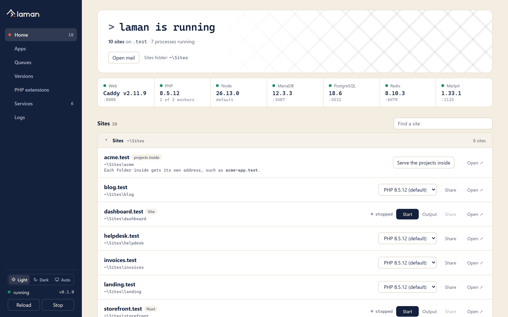

<p align="center">
  <picture>
    <source media="(prefers-color-scheme: dark)" srcset=".github/assets/logo-dark.svg">
    
  </picture>
</p>

<p align="center">
  A local PHP development environment for Windows: PHP, MariaDB and HTTPS <code>.test</code> sites, with nothing to configure.
</p>

<p align="center">
  <a href="https://github.com/raditzfarhan/laman/releases/latest"></a>
  <a href="https://github.com/raditzfarhan/laman/actions/workflows/ci.yml"></a>
  <a href="https://github.com/raditzfarhan/laman/releases"></a>
  
  <a href="go.mod"></a>
  <a href="LICENSE"></a>
</p>

<p align="center">
  <picture>
    <source media="(prefers-color-scheme: dark)" srcset=".github/assets/dashboard-dark.png">
    
  </picture>
</p>

A local PHP development environment for Windows, in the spirit of Laragon and Laravel Herd.
One self-contained `laman.exe` has the [Caddy](https://caddyserver.com) web server built in,
installs PHP and MariaDB, and serves every folder in `~/Sites` at `http(s)://<folder>.test`.
*Laman* is Malay for courtyard, and *laman web* means website.

## Install

Download `laman-setup-<version>.exe` from the [latest release](https://github.com/raditzfarhan/laman/releases/latest) and run it. It needs no administrator rights: laman lives in `%USERPROFILE%\.laman`. On the last page, leave **Download and set up PHP, MariaDB, Composer and Node** ticked for a first install.

The setup program isn't code-signed yet, so Windows SmartScreen may say it "protected your PC": choose **More info → Run anyway**. Each release lists the SHA-256 of every file in `checksums.txt`.

- **Updates:** the dashboard says when a new release is out (**Update now** on Home), or run `laman update`. laman checks GitHub once a day; set `"noUpdateCheck": true` in `config.json` to stop that. Click the version at the bottom of the dashboard's sidebar to check now.
- **Uninstall:** Settings → Apps → laman. It stops laman, takes it off your PATH and out of sign-in, and removes its certificate authority from Windows. It then asks whether to delete your databases and installed PHP versions too (default: keep them). `*.test` lines stay in the hosts file.
- **Without the setup program:** download `laman.exe` from the release and run `.\laman.exe setup`.
- **From source:** Go 1.27+, then `go build -o laman.exe .` and `.\laman.exe setup`. Release builds: `.\scripts\build.ps1 -Version 1.2.3` (needs [Inno Setup 6](https://jrsoftware.org/isinfo.php) for the setup program). Pushing a `v1.2.3` tag builds and publishes the release on GitHub.

## Quick start

```powershell
mkdir ~\Sites\blog     # any folder becomes a site; ./public is used as the web root if present
laman start
laman hosts            # adds blog.test to the hosts file (one UAC prompt)
laman trust            # trusts laman's local CA so https://blog.test has no warnings
```

- **Dashboard:** http://127.0.0.1:7171, or the tray icon. The **Light / Dark / Auto** switch at the bottom of its sidebar sets the look; Auto follows Windows.
- **http://localhost:** lists every site, grouped by project folder, with a search box and a link to the dashboard. Mistyped `.test` names land here too. It uses the dashboard's theme and only this computer can open it.

## Project folders

Every folder inside a project folder becomes a site: `~/Sites/blog` is served as `blog.test`. `~/Sites` is the main project folder, and you can add more, e.g. if some projects live in `C:\laragon\www`:

```
laman folders                         # list them, with how many sites each holds
laman folders add C:\laragon\www      # or `laman folders add` inside the folder
laman folders remove C:\laragon\www   # stops serving it; nothing on disk changes
```

In the dashboard, Home has a **Project folders** panel. **Add folder…** opens Windows' folder picker, or you can paste a path. Each folder has **Open** (in Explorer) and **Remove**, which asks twice.

- **Grouped projects:** if `C:\laragon\www\acme` holds several apps, add it as a project folder too (`laman folders add C:\laragon\www\acme`). `acme` itself is no longer served as a site, and each app inside gets the group's name in front: `acme\api` becomes `acme-api.test`, so generic names like `api` or `docs` don't clash.
- **Name prefix:** any project folder can have one. `laman folders prefix ac C:\laragon\www\acme` names its sites `ac-<app>.test`; `laman folders prefix off <path>` goes back to plain `<app>.test`. In the dashboard, each folder shows how its sites are named, with **Change** / **Add a prefix**.
- **A long list:** on Home, sites are grouped by project folder (links last). Click a group's header to fold it away (remembered in this browser), and use **Find a site** to search every group by name or folder.
- **Same name in two folders:** the folder listed first wins, and Home shows a note naming the one left out. Rename it, or serve it under another name with `laman link <name>` in that folder.
- **Removing the main folder** makes the next one the main folder. The last one can't be removed.
- **One project elsewhere?** `laman link` serves a single folder without adding its parent.
- **Folders that hold projects** (`shop\api`, `shop\web-app`) are tagged **projects inside**. **Serve the projects inside** on Home adds that folder as a project folder, so each one gets its own address (`shop-api.test`). Opening `shop.test` explains the same.
- **Not websites:** folders with no `index.php`, `index.html` or `package.json` dev script (Terraform, Docker, docs, notes) go into a folded **Not websites** group at the bottom of Home and the localhost page. Their address shows "Nothing to open here" instead of a bare 404. laman looks again whenever files change.

## JavaScript apps (dev servers)

A Nuxt, Next.js, Vite, Quasar, Vue CLI, Astro or Node server project can't be served from its folder: it needs its dev server. laman finds these from `package.json` and runs the dev server for you, behind the project's `.test` name, with HTTPS and live reload.

```
laman dev                      # Node apps and whether their dev servers run
laman dev start [site]         # start one (default: the current folder's), waits until it answers
laman dev stop [site]
laman dev log [site]           # its latest output
laman dev auto on|off [site]   # start it whenever laman starts
```

- **On Home** each Node app shows its framework, **running · :3101** / **stopped** / **crashed**, **Start** / **Stop**, and **Output** (live output, plus **Start with laman**).
- **The command** is the project's own `dev` script (else `serve`, else `start`), run with the package manager its lock file names (`pnpm-lock.yaml` → pnpm, `yarn.lock` → yarn, `bun.lock` → bun, else npm). Quasar apps without a script run `quasar dev`; Express/Fastify/Koa servers without one run `node <main>`.
- **The port** is picked by laman (3100–3999) and passed as `--port` to Vite, Nuxt, Next, Astro, Quasar, Vue CLI and Angular, and as `$PORT` to everything. If a server prints a different `http://localhost:<port>`, laman follows that.
- **No config changes needed:** the dev server sees its requests as coming for `localhost:<port>`, so Vite's and Nuxt's host check lets them through. The original name is in `X-Forwarded-Host`.
- **Node version:** the project's `.nvmrc` / `.node-version` if that version is installed in laman, else laman's default Node, else whatever Node is on PATH.
- **While it's stopped**, the `.test` address explains that and links to **Start it in the dashboard**. The dashboard asks before starting anything; a link alone never runs a command. Once the server answers, that page turns into the app by itself. A crash shows the last lines of output there and on Home.
- **Stopping** ends the whole process tree (npm → node → esbuild), so no stray process keeps the port. Dev servers stop with laman and are never restarted on their own.
- **Install packages first:** laman doesn't run `npm install` for you; Start says so if `node_modules` is missing.
- **Sharing** works for a running dev server, like any site.

### Proxies

For anything laman doesn't start, such as a Docker container or a server you run by hand, point a name at its port:

```
laman proxy api 8080           # https://api.test/ -> 127.0.0.1:8080
laman proxy                    # list them
laman proxy remove api
```

Only ports on this computer are allowed. While nothing answers there, the address says so and reloads once the port answers. New names need a hosts entry (`laman hosts`), like any new site.

## Choosing which servers run

MariaDB, PostgreSQL, Redis and Mailpit each have an on/off switch. Caddy and PHP are laman itself and always run.

- **Switching:** run `laman disable postgres` / `laman enable postgres`. You can also use the **Starts with laman** switch in the dashboard's Services table, or **Services ▸** in the tray.
- **Immediate and remembered:** turning a server off stops it now and keeps it off on every `laman start`. Turning it on starts it now. Nothing else restarts.
- **No port clash:** a server that's off never has its port checked, so another copy (WSL, Docker, Laragon) can keep that port.
- **Default:** everything is on. The settings live in `services` in `config.json`.
- **While off:** `laman use` still switches a server's version, and it stays off. `laman upgrade` asks you to turn it on first, because the upgrade finishes against the running server.

## Versions

| | Several installed | Switch the default | Per project |
|---|---|---|---|
| PHP | yes | `laman use php 8.4` | `laman isolate 8.3` |
| Node | yes | `laman use node 22` | `.nvmrc` / `.node-version` via `laman node`/`npm`/`npx` |
| MariaDB | yes | `laman use mariadb 11.4` | no: one server for every site |
| PostgreSQL | yes | `laman use postgres 17` | no: one server for every site |
| Redis | yes | `laman use redis 7.4` | no: one server for every site |
| Composer, Mailpit | latest only | `laman composer self-update`, `laman install mailpit` | no |

**From the dashboard and the tray:**
- **Dashboard Versions table:** for each component, **Use** switches versions and **Install** adds a version, choosing from what php.net, nodejs.org, MariaDB, postgresql.org and redis-windows offer.
- **Dashboard upgrades:** databases also get **Upgrade…**, which asks for a second click because it restarts laman. It runs `laman upgrade` in the background, with progress in **Logs > Upgrade**, and the page reconnects by itself.
- **Tray:** **Versions ▸ PHP ▸ ✓ 8.5.12** (and the same for each component) for quick switching.
- **No full restart:** switching a database from the dashboard, the tray or `laman use` (while laman runs) restarts only that server, which takes about two seconds. Sites and PHP keep serving.

**Database data:** each line (MariaDB `12.3`, PostgreSQL `18`, Redis `8.10`) keeps its own data folder in `~/.laman/data` (`mariadb-12.3`, `postgres-18`, `redis-8.10`). An older server can't safely read files a newer one wrote, so laman never shares a folder between lines.

- **Installing never switches.** `laman install mariadb 13.0` puts it alongside, and laman keeps running the pinned line. The exception is a patch release of the pinned line, which runs from the next restart.
- **`laman upgrade mariadb [13.0]`** stops the server and copies the data to the newer line. It then starts that line and runs `mariadb-upgrade`.
- **`laman upgrade postgres [19]`** converts the cluster with `pg_upgrade` in copy mode, matching the old cluster's checksum setting, then rebuilds planner statistics with `vacuumdb`.
- **`laman upgrade redis [8.12]`** copies the data, which newer Redis can read.
- **The old folder stays untouched,** so `laman use mariadb 12.3` (etc.) takes you back. Delete it once you're happy.
- **If an upgrade fails** before switching, laman restarts on the old version as if nothing happened.
- **`laman use mariadb 11.4`** switches lines. A line that has no data yet starts empty, and your other line's data stays where it is.
- **Port clashes:** if another program (WSL, Docker, Laragon) holds a database or Mailpit port, laman starts without that one server and says why in `laman status` and the dashboard.

## PostgreSQL

`laman install postgres [17]` installs PostgreSQL (the newest supported major when omitted) and turns on `pdo_pgsql` / `pgsql` in every PHP.

- **Server:** `127.0.0.1:5432`, superuser `postgres`, no password for connections from this machine, with UTF-8 encoding and the `C` locale.
- **psql:** `laman psql` connects as `postgres`, e.g. `laman psql -c "CREATE DATABASE myapp"`.
- **Laravel:** `DB_CONNECTION=pgsql`, `DB_HOST=127.0.0.1`, `DB_PORT=5432`, `DB_USERNAME=postgres`, `DB_PASSWORD=` (empty).
- **Where it comes from:** the Windows binaries are EnterpriseDB's, the source postgresql.org links to. EDB publishes no checksums, so laman relies on HTTPS from get.enterprisedb.com. pgAdmin and StackBuilder are skipped, which brings the ~320 MB zip down to ~140 MB installed.

## Apps

Apps are web tools that sit beside your servers. Each one lives in `~/.laman/apps/<name>` and is served at its own `.test` address, with HTTPS like your sites.

| App | Address | What it is |
|---|---|---|
| `dbzuper` | `https://dbzuper.test` | [DBZuper](https://github.com/dbzuper/dbzuper): visual database workspace for MariaDB, PostgreSQL and SQLite. **The default database app.** |
| `adminer` | `https://adminer.test` | Adminer: a one-file manager for MariaDB and PostgreSQL. Signs in to laman's servers without a password. |
| `phpmyadmin` | `https://phpmyadmin.test` | phpMyAdmin, signed in as `root` to laman's MariaDB. |
| `phpredisadmin` | `https://redis.test` (and `https://phpredisadmin.test`) | [phpRedisAdmin](https://github.com/ErikDubbelboer/phpRedisAdmin): browse, edit and delete Redis keys, and see server info. Connected to laman's Redis with no login, since it is only reachable from this computer. |

**`https://db.test` is your database app.** It opens DBZuper, or whichever database app you choose:

```
laman app                        # list apps: installed version and address
laman app install dbzuper        # or adminer, phpmyadmin
laman app update dbzuper         # newest version; keeps its data (accounts, connections, history)
laman app remove adminer         # asks first: removes the app and what it stored
laman app open phpmyadmin
laman app default adminer        # db.test opens Adminer instead
laman db                         # opens db.test
```

The dashboard has an **Apps** view (Install, Open, Update, Use for db.test, Remove) and a **Database ↗** button on Home.

- **PHP version:** each app runs on a PHP version it supports. DBZuper needs 8.4 or newer, and phpMyAdmin 5.2 supports below 8.4. laman uses your default PHP when it fits, otherwise the newest installed version that does. If none does, it installs one (e.g. PHP 8.3 for phpMyAdmin), and the app is pinned to it the same way as `laman isolate`.
- **DBZuper:**
  - **Install:** it's built from its latest GitHub release with laman's Composer, PHP and Node, installing Node first if needed. Allow a few minutes the first time.
  - **Ready to use, no setup** (DBZuper 0.3 and newer):
    - laman creates your account from git's `user.name` / `user.email`. Without git it uses your Windows account's full name (or username), and `you@laman.test` as the email. Change either in DBZuper's Settings → Profile.
    - It turns on `DBZUPER_AUTO_LOGIN`, so this computer opens DBZuper already signed in, with no password. That only works for requests from this computer, at a `.test` or local address.
    - **Two keys:** the setting in DBZuper's `.env` does nothing by itself. laman generates a random key on every install or update, puts its hash in `.env`, and only laman's web server hands DBZuper the key itself, as a server variable that a visitor cannot send. Copying that `.env` to a server signs no one in. The key lives in `~/.laman/apps/dbzuper.server-env`; keep it private.
    - It adds **laman MariaDB** and **laman PostgreSQL** connections for the servers you have.
    - The account's password is random. If you ever need one, set it with `laman php artisan dbzuper:reset-password` in `~/.laman/apps/dbzuper`.
    - With older DBZuper versions, laman prints the setup code instead.
  - **Building from your own checkout:** `laman app install dbzuper --from C:\path\to\dbzuper` (or `update … --from`) builds from a local source folder instead of the latest release, which is useful when developing DBZuper. It skips the folder's `vendor`, `node_modules`, `.env` and data.
  - **Updates** keep `.env`, `database/database.sqlite` and `storage/app`.
  - **Connecting:** MariaDB is `127.0.0.1:3306`, user `root`, and PostgreSQL `127.0.0.1:5432`, user `postgres`, both with no password.
- **Sources:**
  - Adminer: GitHub, checked against the SHA-256 GitHub lists. When GitHub's file storage is down, laman fetches the same file from adminer.org and checks it the same way.
  - phpMyAdmin: phpmyadmin.net, checked against its published SHA-256.
  - DBZuper: GitHub tag archives have no fixed checksum, so it relies on HTTPS.
- **Adminer passwords:** Adminer only allows a blank password for servers on this computer. Other servers sign in normally, with a password.
- **First time at a new address:** run `laman hosts` once (it asks for admin), the same as for a new site.

## PHP extensions

Each PHP version has its own extensions and its own `php.ini` (`~/.laman/bin/php/<version>/php.ini`). The commands below act on the PHP version of the folder you're in (its site's version, or the default). Add `--php 8.4` to pick another.

**See what's there:**

```
laman ext                      # every extension: on / off / not installed, and where it comes from
laman ext --php 8.4
```

**Enable or disable** an extension that ships with PHP, such as soap, sockets, gmp, bz2, ftp, gettext, ldap, xsl, tidy or odbc:

```
laman ext enable soap
laman ext disable soap
laman ext enable soap sockets gmp   # several at once
```

**Install or uninstall** an extra extension (one that doesn't ship with PHP):

```
laman ext install apcu         # downloads it for this PHP version and enables it
laman ext uninstall apcu       # disables it and removes its files
```

The extras laman can install are `xdebug`, `apcu`, `igbinary`, `mongodb`, `redis` (phpredis) and `imagick`. Each is installed per PHP version, so for 8.4 and 8.5 you run it once for each (`--php 8.4`, `--php 8.5`).

- **Sources:** Xdebug comes from xdebug.org and is checked against the SHA-256 it publishes. The rest are php.net's official Windows builds, which have no checksums, so laman relies on HTTPS from php.net.
- **Imagick** brings ImageMagick's libraries with it, which go next to `php.exe`. `uninstall` removes them again.
- Extensions that ship with PHP can't be uninstalled, only disabled.

**Xdebug shortcut:**

```
laman xdebug on                # installs it the first time, then just switches it on
laman xdebug off
```

laman sets Xdebug to `xdebug.mode = debug,develop` with `start_with_request = trigger`. It only steps in when a request asks for it, through a browser extension or `XDEBUG_TRIGGER`. It listens on port 9003, the default in VS Code and PhpStorm, so normal page loads stay fast. Turn it off when you're not debugging.

**From the dashboard:** the **PHP extensions** panel has a PHP version picker, a filter, a switch per extension, **Install** for extras, and **uninstall** for installed extras.

**When changes apply:** every change restarts only that PHP version's workers, so your sites see it within a second. Other PHP versions and the databases keep running. `laman php` and `laman composer` read `php.ini` on every run, so they pick changes up immediately.

**By hand:** you can still edit `php.ini` yourself, and laman reads it the same way. Add `extension=soap` (or `zend_extension=xdebug` for Xdebug), or put `;` in front of a line to switch it off. Then run `laman restart`.

## Mail

With Mailpit installed (`laman setup` does it), laman runs it next to PHP and MariaDB. Nothing reaches a real inbox.

- **SMTP:** `127.0.0.1:1025`. It accepts any username and password, so apps set up for a real provider still deliver.
- **Inbox:** http://127.0.0.1:8025, or run `laman mail`, the dashboard's **Open mail** button or the tray's **Open mail** item.
- **`mail()`:** PHP's `mail()` already goes to Mailpit, from sites and from `laman php`.
- **Laravel:** set `MAIL_MAILER=smtp`, `MAIL_HOST=127.0.0.1`, `MAIL_PORT=1025` in `.env`.
- **Ports:** change them with `smtpPort` / `mailUiPort` in `config.json`.

## Redis

`laman install redis` installs Redis 8 and adds the `redis` extension (phpredis) to every installed PHP. PHP versions installed later get the extension automatically. Run `laman restart` afterwards.

- **Server:** `127.0.0.1:6379`, with its data in `~/.laman/data/redis`. A clean stop saves the data to disk.
- **CLI:** `laman redis` runs `redis-cli` against it, e.g. `laman redis keys '*'`.
- **Laravel:** set `REDIS_HOST=127.0.0.1` and `REDIS_PORT=6379`, then `CACHE_STORE`, `QUEUE_CONNECTION` or `SESSION_DRIVER` to `redis`.
- **Browsing keys:** `laman app install phpredisadmin` serves phpRedisAdmin at `https://redis.test`; the dashboard's Home gets a **Redis ↗** button.
- **Queues:** the dashboard's **Queues** view shows the Laravel jobs of every site, whether it queues in Redis (`QUEUE_CONNECTION=redis`) or in its own database (`database`, Laravel's default). Only queues with something waiting, delayed, running or failed get a row, failures first; the other sites fold into **Idle**, **Not checked** (with the reason, e.g. a database on another server or no `jobs` table) and other drivers such as `sync`. **Show jobs** lists the jobs by class with their age and attempts, and failed ones with the first line of their error. **Clear** (two clicks, Redis queues only) deletes the waiting and delayed jobs. laman reads each site's `.env` the way Laravel does (`DB_CONNECTION`, `DB_QUEUE_CONNECTION`, `DB_QUEUE_TABLE`, `DB_*`; for Redis `REDIS_PREFIX`, else `APP_NAME`, and `REDIS_DB`) and only reads: MySQL/MariaDB, PostgreSQL and SQLite databases on this computer, through laman's default PHP, while the page is open.
- **Where it comes from:** Redis has no official Windows build. laman uses [redis-windows](https://github.com/redis-windows/redis-windows), which builds current Redis with MSYS2 in public GitHub Actions, and checks it against the SHA-256 GitHub records. php.net publishes the phpredis builds without checksums, so laman relies on HTTPS from php.net for those.

## Sharing a site

`laman share` (in a project folder, or `laman share blog`) gives the site a public HTTPS link such as `https://random-words.trycloudflare.com`, through a free [Cloudflare quick tunnel](https://developers.cloudflare.com/tunnel/get-started/quick-tunnels/). No account is needed. Useful for showing work to a client, testing on a phone, or receiving webhooks. In the dashboard, each site has a **Share** button, and a shared site shows its link with **Copy link** and **Stop sharing**.

- **Stop:** `laman share stop [site]`, the dashboard button, or stopping laman. `laman share list` shows what is shared.
- **The link changes each time you share**, unless you use your own domain (below).
- **First use** downloads `cloudflared` from Cloudflare's GitHub releases, checked against the SHA-256 GitHub records.
- **How it works:** laman serves the site on a private local port of its own and points the tunnel there, so only that site is reachable. PHP sees HTTPS and the public host name, so Laravel builds correct links. Dotfiles stay blocked, as locally.
- **Never shared:** laman's apps (DBZuper, Adminer, phpMyAdmin), and the keys laman gives them.
- **Your own cloudflared setup** (`~/.cloudflared/config.yml`) is left alone: laman gives its tunnels an empty config of their own.
- **Vite:** while `npm run dev` runs, pages load assets from your computer and look broken to others. Run `npm run build` first.
- **Limits of quick tunnels:** no Server-Sent Events, and Cloudflare limits how many requests a quick tunnel handles at once, so it suits previews, not load tests.

### On your own domain

With a domain whose DNS is on Cloudflare (the free plan is enough), shared sites get fixed addresses such as `https://blog.example.com`. These stay the same every time, which suits webhooks, OAuth callback URLs and links you send to clients.

```
laman share setup example.com                  # once: sign in to Cloudflare in the browser, pick example.com
laman share                                    # this folder's site at https://<site>.example.com
laman share blog --as demo                     # blog.test at https://demo.example.com
laman share --quick                            # a random trycloudflare.com link instead
laman share setup example.com --pattern {site}-dev   # addresses like blog-dev.example.com
laman share setup off                          # back to random links
```

- **From the dashboard:** **Services → Sharing** has the same setup: enter the domain, optionally tick **Add -dev to every address**, and click **Connect to Cloudflare**. If the browser doesn't open, the dashboard shows the sign-in link. Once connected, each site's **Share** uses your domain, and its **▾** menu shares under another name or on a random link. **Use random links instead** switches back.
- **Setup:** `laman share setup` opens Cloudflare's sign-in in your browser. You approve it there and choose the domain; laman never sees your password. laman then creates a tunnel named `laman-<computer>`. Its sign-in and tunnel credentials stay in `~/.laman/etc/cloudflared`, separate from any `~/.cloudflared` setup of your own.
- **DNS:** the first time an address is shared, laman adds a DNS record for it, pointing at the tunnel. The record stays afterwards. While the address isn't shared, visitors get a "Not shared right now" page, or Cloudflare's tunnel-offline page when laman isn't sharing anything. Remove unused records in Cloudflare's DNS settings.
- **One tunnel:** all shares on your domain use the one tunnel, and laman routes each address to its site, so starting or stopping one share doesn't interrupt the others. The tunnel runs only while something is shared.
- **One level deep:** Cloudflare's free certificate covers `*.example.com`, so a pattern must stay one level (`{site}` or `{site}-dev`, not `{site}.dev`).

## Node.js

laman can manage Node on its own, with no other Node or nvm needed. `laman setup` installs the current LTS.

- **Installing:** `laman install node` installs the newest LTS. `laman install node 22` installs a major line, and `laman install node 22.11.0` an exact version. Each zip comes from nodejs.org and is checked against its SHASUMS256.txt.
- **Plain `node` / `npm` / `npx`:** `~/.laman/node` is a junction (no admin needed) to the default version, and it's on your user PATH. That makes plain `node`, `npm`, `npx`, npm scripts, Vite and your IDE all use it. `laman use node 20` switches the default.
- **Global tools:** `npm i -g` installs into `~/.laman/npm`, which is shared by every Node version and on PATH. Global tools keep working after a switch.
- **Per project:** `laman node|npm|npx …` uses the version in the nearest `.nvmrc` or `.node-version`, else the default. Child processes, such as npm scripts, get the same Node.
- **Existing installs:** if another Node or nvm comes earlier on PATH, plain `node` keeps running that one, and laman tells you which. Uninstall it, or remove it from PATH, to hand Node over to laman.

## Branding

The icon, tray mark and dashboard colours come from `../logo/kit` (see its `USAGE.md`).

- `winres/laman.ico` is built from the kit's `icons/` (16–256 px). After changing it, run `go generate` to rebuild `rsrc_windows_amd64.syso`. That file is where `laman.exe` gets its icon, its version info and its DPI-aware manifest.
- The tray mark is drawn in code from the kit's tray geometry (`internal/tray/icon.go`). `LAMAN_ICON_PREVIEW=<dir> go test ./internal/tray -run Preview` writes a preview sheet.

## Commands

| Command | What it does |
|---|---|
| `laman setup` | Install PHP, MariaDB and Composer and create the sites folder |
| `laman install php [8.4]` / `mariadb [11.4]` / `postgres [17]` / `redis [7.4]` / `composer` | Install a version alongside the others (Composer: latest stable) |
| `laman use mariadb\|postgres\|redis <ver>` | Switch the database line (each keeps its own data) |
| `laman upgrade mariadb\|postgres\|redis [ver]` | Move to a newer line with your data; the old data is kept as a way back |
| `laman psql [args]` | psql against laman's PostgreSQL as `postgres` |
| `laman versions` | List versions (`*` = in use) |
| `laman use php 8.3` | Set the default PHP version (applies live, no restart) |
| `laman isolate 8.3 [site]` / `unisolate [site]` | Pin a site (default: the folder you are in) to a PHP version |
| `laman php [args]` | Run the PHP CLI matching the site you are in, e.g. `laman php artisan migrate` |
| `laman ext [--php 8.4]` | List PHP extensions; `laman ext enable\|disable\|install\|uninstall <name>` changes them (see [PHP extensions](#php-extensions)) |
| `laman xdebug on\|off` | Turn Xdebug on or off for this folder's PHP (installs it the first time) |
| `laman app [install\|update\|remove\|open\|default] <name>` | Web apps: dbzuper, adminer, phpmyadmin (see [Apps](#apps)) |
| `laman db` | Open the default database app at `https://db.test` |
| `laman composer [args]` | Run Composer with that same PHP, e.g. `laman composer create-project laravel/laravel blog`. Installs Composer (checksum-verified) on first use; `laman composer self-update` updates it |
| `laman install mailpit` / `laman mail` | Install Mailpit, which catches every email your apps send, and open its inbox |
| `laman install redis` / `laman redis [args]` | Install Redis and phpredis; run `redis-cli` against it |
| `laman share [site] [--as name] [--quick]` / `share stop [site]` / `share list` | Share a site on a public HTTPS link (see [Sharing a site](#sharing-a-site)) |
| `laman share setup <domain> [--pattern {site}-dev]` / `share setup off` | Share on your own Cloudflare domain instead of random links |
| `laman dev [start\|stop\|log] [site]` / `dev auto on\|off [site]` | Run a Node app's dev server behind its `.test` name (see [JavaScript apps](#javascript-apps-dev-servers)) |
| `laman proxy <name> <port>` / `proxy remove <name>` / `proxy` | Serve `<name>.test` from a port on this computer |
| `laman install node [22]` / `laman use node 22` | Install Node.js (newest LTS by default) and set the default behind plain `node`/`npm`/`npx` |
| `laman node\|npm\|npx [args]` | Run with the project's `.nvmrc` / `.node-version` Node, else the default |
| `laman start` / `stop` / `restart` / `status` | Control the background daemon |
| `laman sites` | List sites, URLs and document roots |
| `laman folders` / `folders add [path]` / `folders remove [path]` / `folders prefix <prefix> [path]` | Project folders: every folder inside one is a site (see [Project folders](#project-folders)) |
| `laman link [name] [path]` / `unlink <name>` | Serve one folder outside your project folders |
| `laman hosts` | Sync `*.test` entries into the hosts file |
| `laman trust [--reset]` / `untrust` | Trust or remove laman's local CA (`--reset` makes a new one) |
| `laman config` | Show the config file |
| `laman tray` | Show the notification-area icon (start/stop, sites, dashboard, Start with Windows) |
| `laman dashboard` | Open the dashboard at `http://127.0.0.1:7171` |
| `laman self-install` | Copy this laman.exe to `~/.laman/bin` and add that folder to your user PATH (also run by `setup`; rerun after rebuilding) |
| `laman update [--check]` | Install the newest release (checksum-verified); `--check` only says whether there is one |
| `laman version` | Print laman's version (`dev` for a local build) |
| `laman self-uninstall` | Stop laman and remove it from PATH, sign-in and the Windows certificate store; your data stays |

## How it works

- **Layout:** everything lives in `%LAMAN_HOME%` (default `~/.laman`): `bin/<php|mariadb>/<version>`,
  `data/mariadb`, `etc/caddy/Caddyfile` (generated, for reference), `etc/ca`, `etc/certs`,
  `logs/`, `config.json`.
- **Web server:** Caddy runs inside the laman daemon as a Go library; there is no separate web
  server to install or keep running. laman renders a Caddyfile and loads it in-process.
  Loading is synchronous and graceful, so a new or linked site is live when the command returns.
- **PHP versions:** every PHP version a site needs gets its own pool of `php-cgi` workers on its
  own block of ports; the default version always has one, and pools nobody uses are stopped.
  Each install gets its own OPcache id (`opcache.cache_id`) so two copies of the same PHP build
  never share a cache, and `opcache.revalidate_freq=0` makes file edits show up immediately.
- **Daemon:** `laman start` launches `laman daemon` detached. It supervises the pools of `php-cgi`
  workers (restarting any that exit; Caddy retries a busy or restarting worker) and MariaDB.
  Every child is in a Windows job object, so if the daemon dies they die with it and never hold
  ports hostage.
- **Sites:** the daemon rescans `~/Sites` every 2 s. A site whose web root has `index.php` gets
  front-controller routing (Laravel, WordPress: unknown paths go to `index.php`). Other sites are
  served as static files, with `.php` files still executed and real 404s for missing pages.
  Dotfiles other than `/.well-known/` return 403.
- **Hosts file:** laman owns only the block between `# BEGIN laman` and `# END laman`. Writing it
  needs admin; `laman hosts` asks via UAC. `laman status` warns when entries are missing.
- **HTTPS:** laman keeps a local certificate authority in `etc/ca` and issues each site its own
  certificate in `etc/certs`, renewing them 30 days before expiry. Every site answers on both
  HTTP and HTTPS (HTTP/2 and HTTP/3). The CA is *name constrained* to the dev TLD, `localhost`
  and loopback IPs, so even a leaked CA key cannot impersonate real websites. `laman trust` adds
  it to the current user's Windows root store (one confirmation dialog, no admin), which Chrome
  and Edge use; fully restart the browser afterwards, since a running browser keeps its old trust decisions. Caddy's own automatic HTTPS is switched off. If you change `tld`, run
  `laman trust --reset`.
- **Tray:** `lamanw.exe` is a copy of `laman.exe` with its PE subsystem flag set to GUI (made by
  `self-install`/`laman tray`), so the tray never opens a console window, even at sign-in.
- **Dashboard:** served by the daemon on the control port. Its page and script load without
  credentials, but every action goes through the API, and the page cannot be framed.
- **Control API:** `127.0.0.1:<controlPort>`. Requests need an `X-Laman-Client: 1` header and a
  loopback `Host`, so web pages can't forge calls to it.
- **Downloads:** PHP and MariaDB zips are SHA-256 verified against their official metadata.
  PHP gets a `php.ini` with common extensions enabled and curl's CA bundle for HTTPS.

## Defaults (`config.json`)

`httpPort` 80, `httpsPort` 443 (0 disables HTTPS), `mysqlPort` 3306 (user `root`, no password),
`phpBasePort` 9100 with `phpWorkers` 4, `controlPort` 7171, `tld` "test". Ports clash with
Laragon if it is running; stop it or change the ports.

## Not yet

Plain `php` and `composer` are left alone: Laragon's sit on the machine PATH, which Windows searches before the user PATH, so use `laman php` and `laman composer`.
